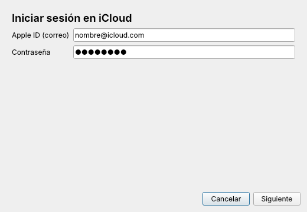
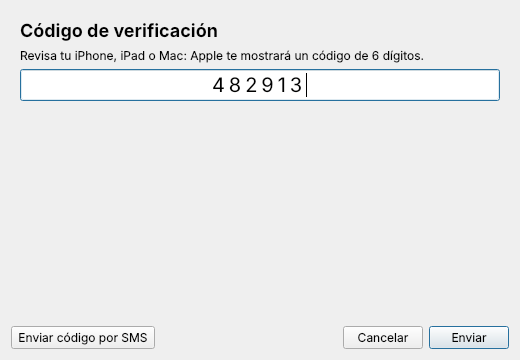
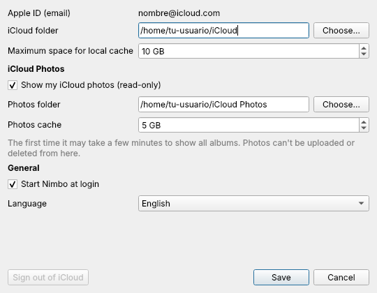

# Nimbo

**iCloud Drive como una carpeta más en Linux.** Nimbo pone un icono en la bandeja del sistema, te guía para iniciar sesión con tu Apple ID y el código 2FA, y monta tu iCloud Drive en `~/iCloud`. Desde ahí lo usas con Dolphin, Nautilus o cualquier programa, como en macOS.

*English summary below.*

<p align="center">
  
  
</p>

> Nimbo es un proyecto independiente y no está afiliado a Apple. iCloud es una marca de Apple Inc.

## Qué hace

- **Carpeta montada:** ves todos tus archivos sin descargarlos. Un archivo se descarga cuando lo abres y lo que guardas se sube solo, como con "Optimizar almacenamiento" en el Mac.
- **Caché local con límite:** los archivos que usas quedan disponibles al instante. Tú eliges cuánto espacio ocupa (10 GB por defecto).
- **Icono de estado:** verde si está conectado, azul si está sincronizando, naranja si hay que volver a iniciar sesión, rojo si hay un error.
- **Aviso de sesión caducada:** Apple pide repetir el 2FA más o menos cada 30 días. Nimbo te avisa y te pide el código en una ventana, sin terminal.
- **Se monta al arrancar** mediante un servicio de usuario de systemd, aunque cierres la app.
- **iCloud Fotos (opcional, solo lectura):** una segunda carpeta, `~/Fotos de iCloud`, con tus fotos y videos organizados por biblioteca y álbum, igual que en la app Fotos. Usa la misma sesión que iCloud Drive, así que no hay que repetir el código 2FA.
- **Español e inglés:** por defecto usa el idioma del sistema. Puedes cambiarlo en Preferencias → Idioma y se aplica al instante.

Por debajo usa el módulo `iclouddrive` de [rclone](https://rclone.org/iclouddrive/), que es el que habla con Apple. Nimbo añade la interfaz, la gestión de la sesión y la parte de seguridad.

## Requisitos

En tu cuenta de Apple (en el iPhone: Ajustes → tu nombre → iCloud):

1. **"Acceder a datos de iCloud en la web" activado.**
2. Si usas **Protección de datos avanzada**, Apple te pedirá aprobar el acceso en uno de tus dispositivos la primera vez. No hace falta desactivarla.

En el PC: Linux con systemd, FUSE 3, rclone 1.75 o más nuevo (versiones anteriores no pueden iniciar sesión con Apple), Python 3.10 o más nuevo, PySide6 y libsecret (`secret-tool`).

## Instalación

### CachyOS, Arch y derivados

```bash
sudo pacman -S --needed git base-devel
git clone https://github.com/camiool/nimbo.git
cd nimbo/packaging/arch
makepkg -si
```

Después abre **Nimbo** desde el menú de aplicaciones.

### Otras distribuciones

Instala `rclone`, `fuse3`, `libsecret` y PySide6 con tu gestor de paquetes. Luego:

```bash
pipx install git+https://github.com/camiool/nimbo.git
```

## Uso

1. Abre Nimbo. La primera vez se abre el asistente: Apple ID, contraseña y el código de 6 dígitos que aparece en tu iPhone, iPad o Mac (también puedes pedirlo por SMS).
2. Elige la carpeta (por defecto `~/iCloud`) y el tamaño de la caché.
3. Listo. Haz clic en el icono de la bandeja para abrir la carpeta.

### iCloud Fotos

Actívalo en el asistente ("Mostrar también mis fotos de iCloud") o más tarde en **Preferencias → iCloud Fotos**. Aparece una carpeta así:

```
~/Fotos de iCloud/
├── PrimarySync/            ← tu biblioteca personal
│   ├── All Photos/
│   ├── Favorites/
│   ├── Videos/
│   └── (tus álbumes…)
└── SharedSync-XXXX/        ← biblioteca compartida, si tienes una
```

- **Solo lectura:** puedes ver, abrir y copiar fotos a otra carpeta, pero no subirlas, borrarlas ni moverlas. Es una limitación de rclone, no de Nimbo.
- La primera vez, mostrar todos los álbumes puede tardar unos minutos si tienes muchas fotos. Después es casi instantáneo.
- Las fotos que abres se guardan en una caché local con su propio límite (5 GB por defecto).
- Las Live Photos aparecen como dos archivos: la foto y un `.MOV` corto.

### Idioma

Nimbo usa el idioma del sistema: español si tu sistema está en español, inglés en cualquier otro caso. Para elegirlo a mano, ve a **Preferencias → Idioma**.

<p align="center"></p>

Para añadir otro idioma, mira la sección de traducciones en [CONTRIBUTING.md](CONTRIBUTING.md).

Cuando Apple pida verificar otra vez, el icono se pone naranja y aparece una notificación. Haz clic en ella e introduce el código.

## Seguridad y privacidad

- **Sin servidores intermedios.** Tu equipo habla directamente con Apple. Nimbo no envía nada a nadie más.
- **La contraseña nunca va en la línea de comandos.** Los programas que corren en el equipo pueden ver la línea de comandos con `ps`. Nimbo arranca `rclone rcd` en un socket Unix privado (`$XDG_RUNTIME_DIR/nimbo`, permisos `0700`) y le envía las credenciales por ahí.
- **Configuración cifrada.** rclone guarda la sesión (y la contraseña ofuscada) en `~/.config/nimbo/rclone.conf`. Nimbo cifra ese archivo con una clave aleatoria que vive en el llavero del sistema (KWallet o GNOME Keyring, a través de libsecret). Si no hay llavero, avisa antes de guardarlo sin cifrar, con permisos `0600`.
- **Cerrar sesión** (en Preferencias) desmonta la carpeta y borra la configuración, la clave del llavero y la caché local. Tus archivos en iCloud no se tocan.

Ver también [SECURITY.md](SECURITY.md).

## Limitaciones conocidas

- Los cambios hechos desde otros dispositivos tardan alrededor de un minuto en aparecer. No hay notificaciones instantáneas.
- Aún no hay iconos de estado por archivo (nube o check) en el explorador.
- iCloud Fotos es de solo lectura.
- No incluye Contactos, Calendario, Notas ni Recordatorios.
- La API que usa rclone no es oficial. Si Apple la cambia, puede dejar de funcionar hasta que rclone se actualice. Mantén rclone al día.

## Cómo funciona

```
 Bandeja (PySide6) ──► systemctl --user ──┬─► nimbo-mount.service  (Drive)
       │                                   └─► nimbo-photos.service (Fotos, opcional)
       │ socket Unix (estado: subidas, errores)        │
       └──────────────► rclone mount icloud: ~/iCloud │ --iclouddrive-service photos --read-only
                                 │                     ▼
                                 │          rclone mount icloud: ~/Fotos de iCloud
                                 ▼                     │
                       API de iCloud (Apple) ◄─────────┘
                  (misma sesión y clave del llavero para los dos)
```

| Archivo | Qué hace |
|---|---|
| `src/nimbo/rclone.py` | Habla con rclone por socket Unix: alta, 2FA y estado |
| `src/nimbo/service.py` | Genera y controla los servicios de systemd (Drive y Fotos) |
| `src/nimbo/keyring.py` | `nimbo-keyring`: entrega a rclone la clave del llavero |
| `src/nimbo/status.py` | Calcula el estado (conectado, sincronizando, sesión caducada…) |
| `src/nimbo/gui/` | Bandeja, asistente y preferencias |

## Desarrollo

```bash
python -m venv .venv && . .venv/bin/activate
pip install -e '.[dev]'
QT_QPA_PLATFORM=offscreen pytest
ruff check .
python -m nimbo
```

Las contribuciones son bienvenidas. Lee [CONTRIBUTING.md](CONTRIBUTING.md).

## Licencia

[GPL-3.0-or-later](LICENSE). Nimbo es software libre: puedes usarlo, estudiarlo, modificarlo y compartirlo.

---

## English summary

Nimbo is a free (GPL-3.0) tray app that mounts **iCloud Drive as a regular folder on Linux**, similar to macOS, plus an optional **read-only iCloud Photos** folder organized by library and album (same session, no second 2FA). It is built on rclone's `iclouddrive` backend. It handles sign-in and 2FA through a GUI, runs the mount as a systemd user service with a capped VFS cache, and warns you when Apple's session expires (about every 30 days) so you can re-enter the code. The rclone config is encrypted with a random key stored in the system keyring via libsecret, and credentials are never passed on the command line. The interface is available in **English and Spanish**: it follows your system language, and you can switch it under Preferences → Language. Requirements: "Access iCloud Data on the Web" on (Advanced Data Protection is supported; Apple asks you to approve access on a device), rclone ≥ 1.75. Install on Arch/CachyOS with `cd packaging/arch && makepkg -si`. Not affiliated with Apple.
